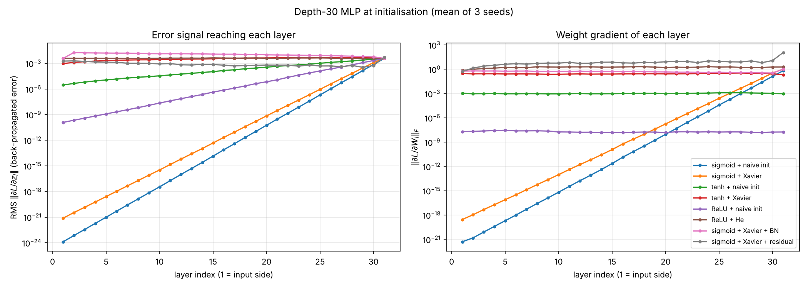
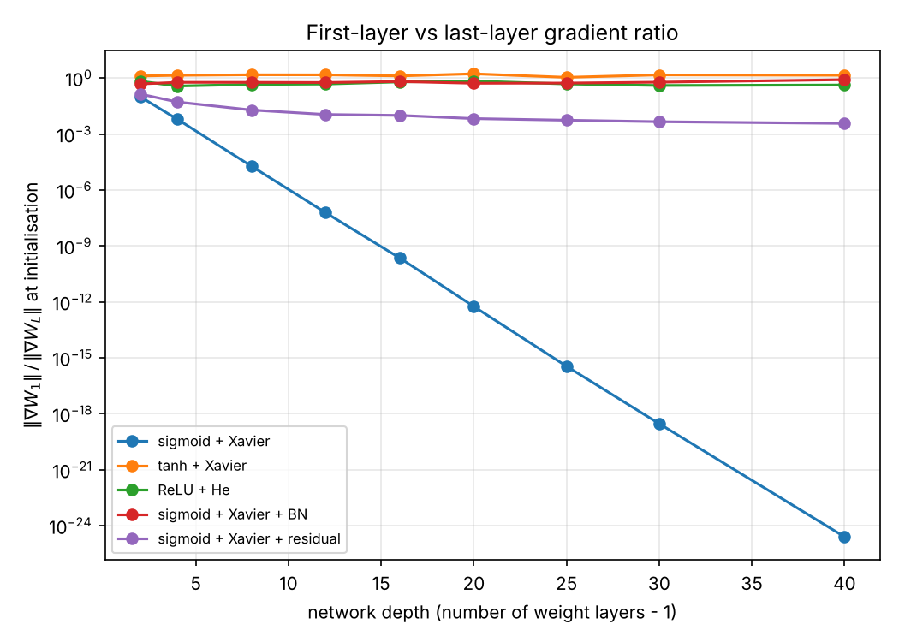
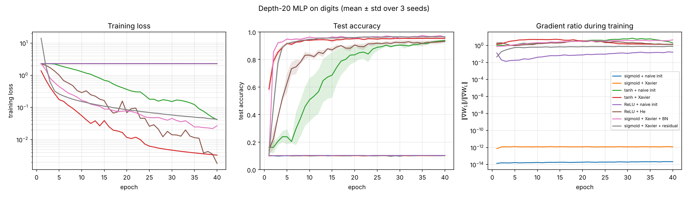

# The Vanishing Gradient Problem: theory and experiments

A small, fully transparent study of **why gradients vanish in deep networks** and
**how common fixes (better activations, Xavier/He initialisation, Batch
Normalisation, residual connections) counter it**.

All networks are implemented in **NumPy with hand-written backpropagation**
([`vg/nn.py`](vg/nn.py)), so every term of the chain rule is visible and the
per-layer gradients can be inspected directly. The backward passes are verified
against finite differences ([`tests/test_gradcheck.py`](tests/test_gradcheck.py)).

---

## 1. Theory

### 1.1 Setup
Consider an $L$-layer fully connected network

$$
z_l = W_l^\top h_{l-1} + b_l, \qquad h_l = \phi(z_l), \qquad l = 1,\dots,L,
$$

with loss $\mathcal{L}$. Define the back-propagated error at layer $l$ as
$\delta_l = \partial \mathcal{L} / \partial z_l$. The chain rule gives the
backward recursion

$$
\delta_{l} = \mathrm{diag}\big(\phi'(z_{l})\big)  W_{l+1}  \delta_{l+1},
\qquad
\frac{\partial \mathcal{L}}{\partial W_l} = h_{l-1} \delta_l^\top .
$$

Unrolling it from the output down to layer $l$:

$$
\delta_l = \Big[\prod_{k=l}^{L-1} \mathrm{diag}\big(\phi'(z_k)\big)  W_{k+1}\Big]  \delta_L .
$$

So the gradient that reaches an early layer is a **product of $L-l$ Jacobians**.
If each factor has a typical gain $\gamma$, then $\|\delta_l\| \sim \gamma^{ L-l}\|\delta_L\|$:
it **vanishes** exponentially if $\gamma<1$ and **explodes** if $\gamma>1$.

### 1.2 Why the sigmoid is the worst case
For $\sigma(z) = 1/(1+e^{-z})$, $\sigma'(z) = \sigma(z)(1-\sigma(z)) \le 1/4$,
with the maximum only at $z=0$. Hence

$$
\|\delta_l\|  \le  \Big(\tfrac14\Big)^{L-l} \prod_{k=l+1}^{L} \|W_k\|_2   \|\delta_L\| .
$$

Unless the weights are large enough to compensate (which then pushes units into
saturation, where $\sigma'\to 0$), the gradient shrinks by at least a factor of
4 per layer. Sigmoid outputs are also **not zero-centred** (mean ≈ 0.5), which
shifts every following pre-activation away from 0 and lowers $\sigma'$ further.

For $\tanh$, $\tanh'(0)=1$, and for ReLU, $\phi'(z)\in\lbrace 0,1\rbrace$, so the
activation itself does not systematically shrink the signal.

### 1.3 Variance-preserving initialisation
Assume i.i.d. zero-mean weights with variance $\mathrm{Var}(W)$ and
fan-in $n$. Propagating variances through one layer (Glorot & Bengio, 2010):

$$
\mathrm{Var}(\delta_l) \approx n_{\text{out}} \mathrm{Var}(W) \mathbb{E}[\phi'(z)^2] \mathrm{Var}(\delta_{l+1}) .
$$

Keeping the gain equal to 1 requires

* **Xavier/Glorot** (tanh, $\phi'(0)=1$): $\mathrm{Var}(W)=\dfrac{2}{n_\text{in}+n_\text{out}}$ (compromise between forward and backward condition);
* **He/Kaiming** (ReLU, half of units are inactive so $\mathbb{E}[\phi'^2]=1/2$): $\mathrm{Var}(W)=\dfrac{2}{n_\text{in}}$.

For a sigmoid, even Xavier gives a per-layer gain of about
$\sigma'(z)\cdot 1 \le 1/4$, so **initialisation alone cannot rescue a deep sigmoid network**.

### 1.4 Architectural fixes
* **Batch Normalisation** (Ioffe & Szegedy, 2015) re-standardises $z_l$ in every
  mini-batch, keeping pre-activations near the high-slope region of $\phi$ and
  re-scaling the backward signal layer by layer.
* **Residual connections** (He et al., 2016), $h_{l+1} = h_l + f(h_l)$, change
  the Jacobian to $I + \partial f/\partial h_l$. The identity term provides a
  path along which $\delta$ flows back **without being multiplied by $\phi'$**:
  $\delta_l = \delta_{l+1} + (\partial f/\partial h_l)^\top \delta_{l+1}$.

---

## 2. Experiments

**Data**: scikit-learn 8×8 handwritten digits (1,797 images, 10 classes; 75/25
stratified train/test split, standardised features). It ships with
scikit-learn, so the project runs offline.
**Model**: MLP of width 64, softmax cross-entropy, SGD with momentum 0.9,
mini-batch 64, 40 epochs. **3 random seeds** per configuration (mean ± std).
**Fair learning rates**: for each configuration the learning rate is chosen
from {0.003, 0.01, 0.03} by validation accuracy (20 % of the training set held
out), and only then evaluated on the test set.

| key | activation | init | extra |
|---|---|---|---|
| sigmoid + naive init | sigmoid | $\mathcal N(0, 0.1^2)$ | – |
| sigmoid + Xavier | sigmoid | Xavier | – |
| tanh + naive init | tanh | $\mathcal N(0, 0.1^2)$ | – |
| tanh + Xavier | tanh | Xavier | – |
| ReLU + naive init | ReLU | $\mathcal N(0, 0.1^2)$ | – |
| ReLU + He | ReLU | He | – |
| sigmoid + Xavier + BN | sigmoid | Xavier | BatchNorm before activation |
| sigmoid + Xavier + residual | sigmoid | Xavier | skip connection per hidden block |

### Exp 1 — gradient profile at initialisation (depth 30)


### Exp 2 — gradient ratio vs. depth


### Exp 3 — training a depth-20 network


### Results
Produced by `python experiments.py` (full numbers in [`results/results.json`](results/results.json)):

| configuration | ‖δ₁‖/‖δ_L‖ at init (depth 30) | ‖∇W₁‖/‖∇W_L‖ at init (depth 30) | selected lr | final train loss (depth 20) | final test acc (depth 20) |
|---|---|---|---|---|---|
| sigmoid + naive init | 3.54e-22 | 7.81e-22 | 0.03 | 2.303 ± 0.000 | 0.101 ± 0.001 |
| sigmoid + Xavier | 2.03e-19 | 2.76e-19 | 0.003 | 2.303 ± 0.000 | 0.101 ± 0.001 |
| tanh + naive init | 7.87e-04 | 1.13e+00 | 0.01 | 0.042 ± 0.031 | 0.939 ± 0.007 |
| tanh + Xavier | 2.60e-01 | 1.50e+00 | 0.01 | 0.003 ± 0.000 | 0.954 ± 0.006 |
| ReLU + naive init | 3.32e-08 | 1.13e+00 | 0.003 | 2.302 ± 0.000 | 0.103 ± 0.001 |
| ReLU + He | 1.01e+00 | 3.76e-01 | 0.003 | 0.002 ± 0.002 | 0.931 ± 0.012 |
| sigmoid + Xavier + BN | 9.90e-01 | 5.68e-01 | 0.01 | 0.027 ± 0.006 | 0.962 ± 0.005 |
| sigmoid + Xavier + residual | 3.46e-01 | 4.61e-03 | 0.03 | 0.043 ± 0.001 | 0.965 ± 0.001 |

(Chance level is 0.10 and $\ln 10 \approx 2.303$, the loss of a uniform prediction.)

### Observations
1. **Deep sigmoid networks do not train at all.** At depth 30 the error
   signal reaching layer 1 is ~10⁻¹⁹–10⁻²² of that at the output (Exp 1). It
   decays geometrically with depth (Exp 2 is a straight line on a log axis, as
   §1.2 predicts). At depth 20 the loss never leaves ln 10 and accuracy stays
   at chance, **with every learning rate tried**. Xavier init does not help here.
2. **The activation matters.** tanh with the same Xavier init keeps
   ‖δ₁‖/‖δ_L‖ ≈ 0.26 and reaches 95 % test accuracy.
3. **The initialisation matters.** With $\mathcal N(0,0.1^2)$ the per-layer
   gain for ReLU is about $0.1\sqrt{64/2}\approx0.57$. After 30 layers both
   the forward activations and δ collapse (~10⁻⁸), and the network stays at chance.
   He init restores a gain ≈ 1 (δ ratio 1.01) and the network trains.
4. **BatchNorm and residual connections fix the sigmoid network.** With
   *the same sigmoid activation that failed completely*, both reach ≈ 96 %
   test accuracy.
5. **Use δ, not only ‖∇W‖, as the diagnostic.** Since $\nabla W_l = h_{l-1}\delta_l^\top$,
   the weight-gradient ratio mixes the backward signal with the size of the
   forward activations. For example, in the residual net $h_L$ grows (it sums
   ~30 sigmoid outputs), which makes ‖∇W₁‖/‖∇W_L‖ look small (4.6·10⁻³) even
   though δ reaches layer 1 almost intact (0.35). For "tanh + naive" and
   "ReLU + naive" the weight-gradient ratio is ≈ 1 because *both* ends are tiny
   (see absolute values in Exp 1). The ratio alone would hide the vanishing.

### Two bugs the checks caught (kept as lessons)
* **Clamped log in the loss.** `log(p + 1e-12)` makes the loss flat when a
  predicted probability falls below 10⁻¹², which happens in deep ReLU-residual
  nets with large logits. The finite-difference check flagged a 6 % gradient
  mismatch. The fix was an exact log-softmax.
* **Tiny last mini-batch with BatchNorm.** 1,347 training samples / 64 left a
  final batch of 3 samples. Its noisy statistics corrupted BN's running
  mean/variance, and test accuracy dropped to ~41 % while validation looked
  fine. Dropping the incomplete batch fixed it (96 %).

---

## 3. Limitations (read before citing these numbers)
* Small dataset (8×8 digits) and plain MLPs; absolute accuracies are not
  comparable to MNIST/CIFAR benchmarks. The *qualitative* gradient behaviour
  is the point.
* Only 3 seeds and a 3-point learning-rate grid; no weight decay, no
  learning-rate schedule, no data augmentation.
* The residual variant has no normalisation, so its activations grow with depth.
  Practical ResNets combine skips with BN or scaled branches.
* The PyTorch script in [`pytorch_version/`](pytorch_version) is a convenience
  port for MNIST and **was not run** to produce any number in this README.

## 4. Reproduce
```bash
pip install -r requirements.txt
python tests/test_gradcheck.py   # verify backprop (finite differences)
python experiments.py            # ~4 min on a laptop CPU; writes figures/ and results/
```

## 5. Project layout
```
vg/nn.py                 NumPy layers, activations, BN, residual blocks, SGD
experiments.py           Exp 1–3, figures, summary table
tests/test_gradcheck.py  finite-difference gradient check (12 configurations)
figures/                 generated plots
results/                 results.json + summary.md
pytorch_version/         optional MNIST port (untested here)
```

## References
* Hochreiter, S. (1991). *Untersuchungen zu dynamischen neuronalen Netzen*. Diploma thesis, TU München.
* Bengio, Y., Simard, P., & Frasconi, P. (1994). Learning long-term dependencies with gradient descent is difficult. *IEEE Trans. Neural Networks*, 5(2), 157–166.
* Glorot, X., & Bengio, Y. (2010). Understanding the difficulty of training deep feedforward neural networks. *AISTATS*.
* He, K., Zhang, X., Ren, S., & Sun, J. (2015). Delving deep into rectifiers. *ICCV*.
* Ioffe, S., & Szegedy, C. (2015). Batch normalization. *ICML*.
* He, K., Zhang, X., Ren, S., & Sun, J. (2016). Deep residual learning for image recognition. *CVPR*.

## License
MIT
